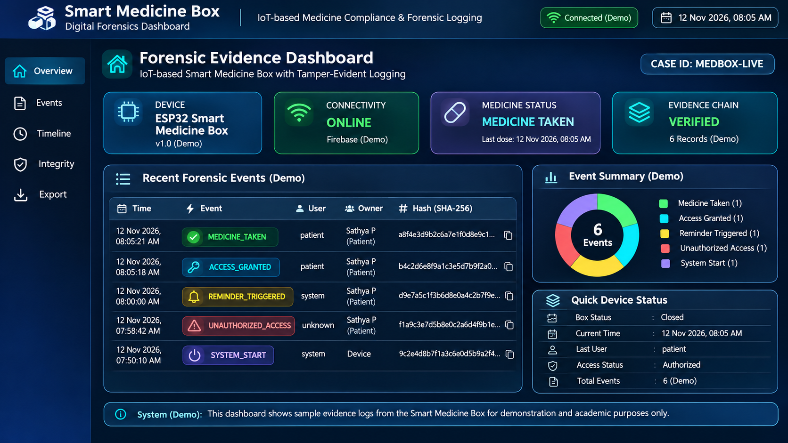
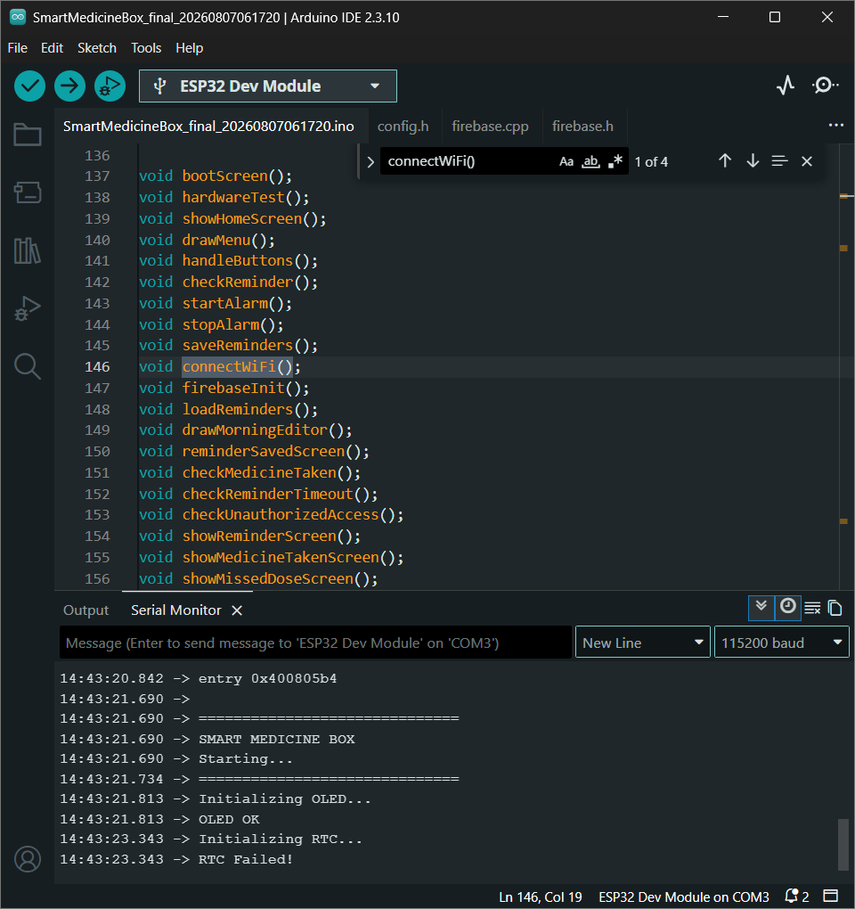
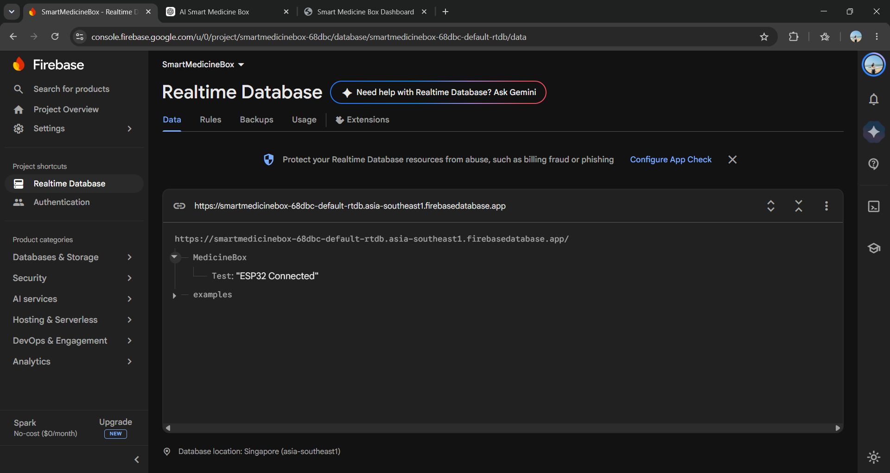
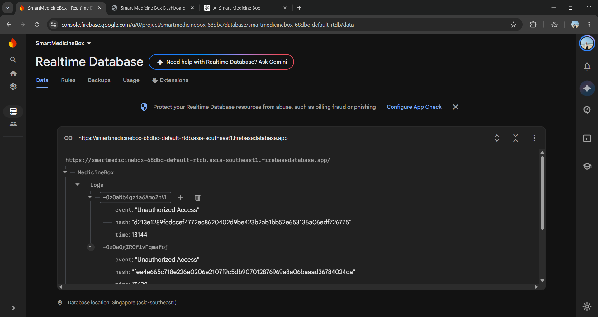
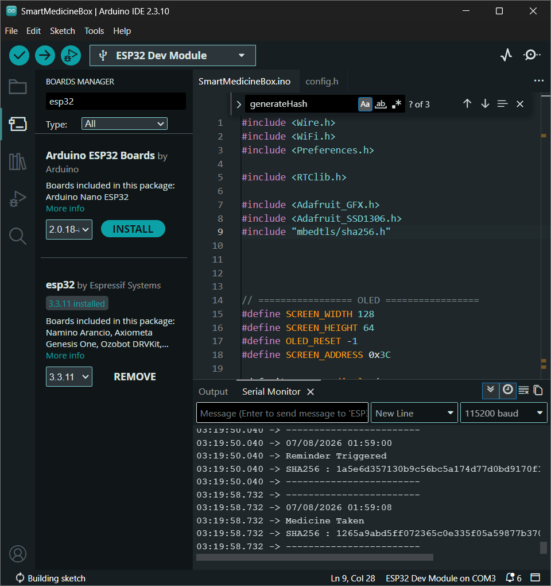
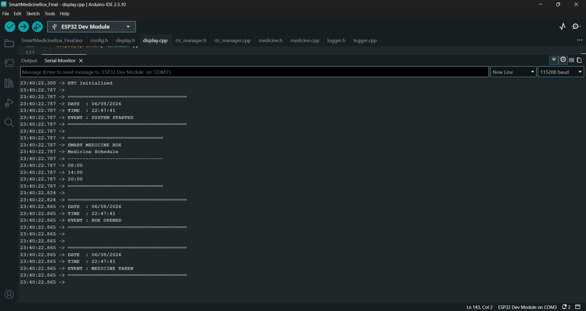

# Smart-Medicine-Box-Forensic-System
IoT-based Smart Medicine Box with Tamper-Proof Medicine Compliance Logging and Digital Forensic Dashboard

# 💊 Smart Medicine Box with Tamper-Evident Forensic Logging

## 📌 Project Overview

The **Smart Medicine Box** is an IoT-based medicine management system designed to assist users in following scheduled medication routines while monitoring medicine box access and maintaining digital forensic records.

The system integrates an ESP32 microcontroller, RTC-based scheduling, access monitoring, audible and visual alerts, Firebase connectivity, and a web-based forensic dashboard.

It records medicine-related events with timestamps and applies SHA-256 hash chaining to help maintain the integrity and traceability of event records.

---

## 🎯 Objectives

- Develop an IoT-based medicine reminder system.
- Provide role-based access functionality.
- Monitor medicine box opening using a reed switch.
- Detect and record unauthorized access events.
- Maintain timestamped digital forensic records.
- Apply SHA-256 hash chaining to event records.
- Store and monitor events through Firebase.
- Provide a web-based forensic dashboard for event monitoring and evidence export.

---

## ✨ Features

- ⏰ RTC-based medicine scheduling.
- 🔐 PIN-based access authentication.
- 👥 Role-based access functionality.
- 🚪 Medicine box opening detection using a reed switch.
- 🚨 Unauthorized access detection.
- 🔔 Audible medicine reminders using a buzzer.
- 🔴 Red LED and 🟢 Green LED status indication.
- 📟 OLED display for system status.
- ☁️ Firebase Realtime Database integration.
- 🧾 Timestamped forensic event logging.
- 🔗 SHA-256 hash-based event integrity mechanism.
- 📊 Web-based forensic dashboard.
- 📈 Forensic event monitoring and timeline.
- 🔍 Hash-chain integrity verification.
- 📤 JSON and CSV evidence export.

---

## 🔧 Hardware Components

| Component | Purpose |
|---|---|
| ESP32 DevKit | Main microcontroller and Wi-Fi communication |
| DS3231 RTC | Date and time management |
| OLED Display (128×64) | Display system status and user interaction |
| Reed Switch | Detect medicine box opening |
| Active Buzzer | Audible reminders and alerts |
| Red LED | Alert indication |
| Green LED | Status indication |
| Push Buttons | Menu navigation and configuration |
| Breadboard | Circuit connections |
| Jumper Wires | Hardware interconnections |

---

## 💻 Software and Technologies

- Arduino IDE
- ESP32
- Embedded C/C++
- Firebase Realtime Database
- HTML
- CSS
- JavaScript
- SHA-256
- Visual Studio Code

---

## 🏗️ System Architecture

The system consists of four major components:

### 1. Hardware Layer

The ESP32 interacts with the RTC, OLED display, reed switch, LEDs, buzzer, and push buttons.

### 2. Firmware Layer

The ESP32 firmware manages:

- Medicine schedules
- User authentication
- PIN verification
- Access authorization
- Medicine box opening detection
- Reminder alerts
- Forensic event generation
- SHA-256 hash generation

### 3. Cloud Layer

Firebase Realtime Database is used for cloud communication and storage of medicine box status and event records.

### 4. Forensic Dashboard Layer

The web dashboard provides event monitoring, forensic log visualization, device status, and evidence export functionality.

---

## 📂 Project Structure

```text
Smart-Medicine-Box-Forensic-System/
│
├── Firmware/
│   ├── SmartMedicineBox_final_20260807061720.ino
│   ├── firebase.cpp
│   ├── firebase.h
│   ├── config.h
│   └── README.txt
│
├── SmartMedicineBox_Forensic_Dashboard/
│   ├── index.html
│   └── README.txt
│
├── Screenshots/
│   ├── dashboard-overview.png
│   ├── firebase-forensic-logs.png
│   ├── firebase-connection.png
│   ├── firmware-hash-testing.png
│   ├── firmware-boot-testing.png
│   └── firmware-event-logs.png
│
└── README.md
```

---

## ⚙️ Firmware

The firmware is developed for the ESP32 using Arduino IDE.

### Pin Configuration

| Hardware | ESP32 GPIO |
|---|---|
| OLED SDA | GPIO 21 |
| OLED SCL | GPIO 22 |
| Buzzer | GPIO 18 |
| Red LED | GPIO 19 |
| Green LED | GPIO 23 |
| Reed Switch | GPIO 4 |
| SET Button | GPIO 25 |
| NEXT Button | GPIO 26 |

### Firmware Functionalities

- RTC-based scheduling.
- PIN-based authentication.
- Schedule configuration.
- Medicine box opening monitoring.
- Unauthorized access detection.
- Medicine taken event recording.
- Medicine reminders.
- Firebase communication.
- Timestamped forensic event logging.
- SHA-256 hash generation.

### Firmware Installation

1. Install Arduino IDE.
2. Install ESP32 board support.
3. Install the required libraries.
4. Open the firmware `.ino` file.
5. Configure your Wi-Fi and Firebase credentials locally.
6. Connect the ESP32 to your computer.
7. Select the appropriate ESP32 board and COM port.
8. Compile and upload the firmware.

---

## 📊 Forensic Dashboard

The Smart Medicine Box Forensic Dashboard is a browser-based interface designed to monitor device status and forensic events.

### Dashboard Features

- Device connectivity status.
- Medicine box status monitoring.
- Recent forensic event stream.
- Event categorization.
- Forensic event timeline.
- SHA-256 hash-chain verification interface.
- JSON evidence export.
- CSV evidence export.

### Dashboard Installation

1. Navigate to the dashboard folder.
2. Open `index.html` using Visual Studio Code.
3. Use Live Server to launch the dashboard.
4. Configure the Firebase web settings.
5. Connect the dashboard to the Firebase Realtime Database.

---

## 📸 Project Screenshots

### 1. Forensic Dashboard Overview

The dashboard displays device status, connectivity, medicine status, forensic event records, event summaries, and evidence-chain status.



---

### 2. Firebase Forensic Event Records

Firebase Realtime Database stores recorded forensic events including event descriptions, timestamps, and hash values.



---

### 3. Firebase Connectivity

Firebase Realtime Database demonstrates communication and connectivity between the ESP32 system and the cloud database.



---

### 4. Firmware Hash and Reminder Testing

Firmware testing using Arduino IDE and Serial Monitor demonstrates medicine reminder events and SHA-256 hash generation.



---

### 5. Firmware Initialization and Testing

Arduino IDE is used to develop, compile, upload, and debug the Smart Medicine Box firmware.



---

### 6. RTC and Medicine Event Logging

Serial Monitor output demonstrates RTC initialization, timestamped system events, medicine box opening, and medicine taken events.



---

## 🔐 Digital Forensic Significance

- Timestamped recording of medicine box activities.
- Monitoring authorized and unauthorized access.
- Maintaining event traceability.
- SHA-256 hash-based integrity mechanism.
- Cloud-based forensic event storage.
- Exportable forensic records for analysis.

---

## ⚠️ Limitations

The current prototype uses a reed switch to detect box opening and does not include an electronic locking mechanism. Therefore, the system detects and logs unauthorized access but does not physically prevent the medicine box from being opened.

Cloud connectivity depends on Wi-Fi availability.

---

## 🔮 Future Enhancements

- Integration with a secure electronic locking mechanism.
- Mobile application for medicine notifications.
- Advanced caregiver monitoring.
- Enhanced cloud analytics.
- Additional authentication mechanisms.
- Improved forensic report generation.
- Automated backup and recovery of forensic records.

---

## 🎓 Project Information

**Project:** Smart Medicine Box

**Domain:** Internet of Things (IoT), Information Security and Digital Forensics

**Platform:** ESP32

**Cloud Platform:** Firebase Realtime Database

**Forensic Technique:** SHA-256 Hash Chaining

---

Developed as an IoT activity/mini project focusing on medicine compliance monitoring and tamper-evident forensic logging.
